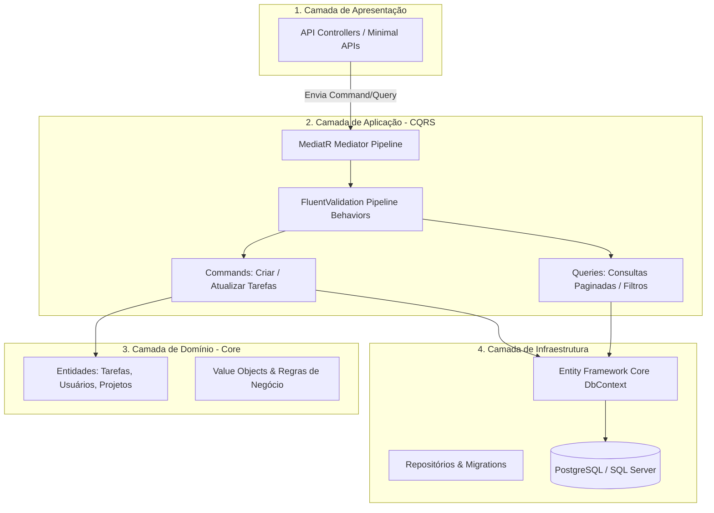
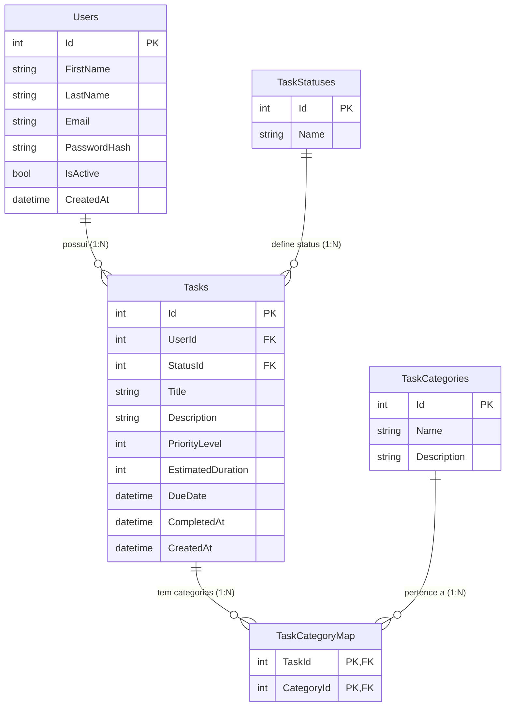

# 🚀 TaskPilot API

O TaskPilot é uma API RESTful desenvolvida em ASP.NET Core que gerencia tarefas e usuários. O projeto segue os princípios da Arquitetura Limpa (Clean Architecture) e utiliza padrões modernos de desenvolvimento, como CQRS (Command Query Responsibility Segregation), para garantir separação de responsabilidades, escalabilidade e manutenibilidade.

## 📐 Arquitetura do Projeto (Clean Architecture / CQRS)



## 📂 Estrutura de Pastas da Solução (Clean Architecture & CQRS)

A solução é organizada estritamente em **4 projetos desacoplados**, garantindo a regra de dependência da Clean Architecture (as dependências apontam sempre de fora para o núcleo de domínio):

```text
TaskPilot.sln
│
├── 🌐 TaskPilot.API/                    # Camada de Entrada e Apresentação
│   ├── Controllers/
│   │   ├── TasksController.cs           # Endpoints de Tarefas (Thin Controller)
│   │   └── UsersController.cs           # Endpoints de Usuários (Login/Registro)
│   ├── Extensions/
│   │   └── ExceptionMiddleware.cs       # Middleware de tratamento global de exceções
│   ├── Program.cs                       # Configuração do Host e Inicialização
│   └── Startup.cs                       # Configuração de IoC e pipeline de middlewares
│
├── ⚙️ TaskPilot.Application/            # Casos de Uso e Orquestração (CQRS)
│   ├── Interfaces/
│   │   └── IExternalApiService.cs       # Porta/Contrato para serviços externos
│   ├── Features/
│   │   └── Tasks/
│   │       ├── Commands/
│   │       │   ├── CreateTask/
│   │       │   │   ├── CreateTaskCommand.cs        # DTO de entrada do comando
│   │       │   │   └── CreateTaskCommandHandler.cs # Handler de criação (Caso de Uso)
│   │       │   └── CompleteTask/
│   │       │       ├── CompleteTaskCommand.cs      # DTO de conclusão de tarefa
│   │       │       └── CompleteTaskCommandHandler.cs
│   │       └── Queries/
│   │           └── GetTaskSummary/
│   │               ├── GetTaskSummaryQuery.cs      # DTO de consulta
│   │               ├── GetTaskSummaryQueryHandler.cs
│   │               └── TaskSummaryDto.cs           # DTO de saída da consulta
│   └── DependencyInjection.cs           # Registro dos Handlers e Serviços no container IoC
│
├── 🏛️ TaskPilot.Domain/                 # Núcleo Central de Domínio (Puro / Sem dependências)
│   ├── Entities/
│   │   ├── User.cs                      # Entidade de Usuário
│   │   ├── Task.cs                      # Entidade de Tarefa
│   │   ├── TaskCategory.cs              # Entidade de Categoria
│   │   ├── TaskStatus.cs                # Entidade de Status
│   │   └── TaskCategoryMap.cs           # Entidade associativa (N:N)
│   ├── Enums/
│   │   └── PriorityLevel.cs             # Níveis de prioridade (Baixa, Média, Alta)
│   ├── Interfaces/
│   │   ├── ITaskRepository.cs           # Contrato de persistência de Tarefas
│   │   ├── IUserRepository.cs           # Contrato de persistência de Usuários
│   │   └── IGenericRepository.cs        # Contrato genérico base
│   └── Exceptions/
│       └── DomainException.cs           # Exceções customizadas para violação de regras
│
└── 💾 TaskPilot.Infrastructure/         # Infraestrutura, Persistência e Acesso a Dados
    ├── Data/
    │   ├── ApplicationDbContext.cs      # DbContext do Entity Framework Core
    │   ├── Configurations/              # Mapeamento Fluent API
    │   │   ├── TaskConfiguration.cs
    │   │   └── TaskCategoryMapConfiguration.cs
    │   └── Repositories/
    │       ├── TaskRepository.cs        # Implementação com EF Core
    │       └── UserRepository.cs
    ├── ExternalServices/
    │   └── NotificationService.cs       # Implementação de integrações externas
    └── DependencyInjection.cs           # Injeção de dependências da infraestrutura
```

---

### 🔍 Detalhamento das Responsabilidades por Camada

| Camada | Projeto | Responsabilidade Principal | O Que Conhece |
| :--- | :--- | :--- | :--- |
| **Apresentação** | `TaskPilot.API` | Ponto de entrada HTTP, roteamento, serialização JSON e tratamento global de erros via `ExceptionMiddleware`. | Conhece `Application` e `Infrastructure` para injeção. |
| **Aplicação** | `TaskPilot.Application` | Implementação do padrão **CQRS** dividido por *Features*. Segrega os comandos de escrita (*Commands*) das consultas de leitura (*Queries*). | Conhece apenas o `Domain`. |
| **Domínio** | `TaskPilot.Domain` | O coração da aplicação. Contém as entidades de negócio, enums, contratos de repositório e regras invariantes. | **100% puro e isolado**. Não conhece nenhuma outra camada. |
| **Infraestrutura** | `TaskPilot.Infrastructure` | Acesso ao banco de dados via Entity Framework Core, mapeamentos Fluent API, repositórios concretos e serviços externos. | Implementa as interfaces do `Domain`. |

---

## 💾 Modelagem do Banco de Dados (Entidades Principais)

A API utiliza um banco de dados relacional (SQL Server por padrão) gerenciado pelo Entity Framework Core. O modelo de domínio é simples, com as seguintes entidades:

| Entidade | Propriedade | Tipo | Descrição |
| :--- | :--- | :--- | :--- |
| **User** | `Id` | `int` | Chave primária. |
| | `Username` | `string` | Nome de login do usuário. |
| | `Email` | `string` | Email do usuário (único). |
| | `PasswordHash` | `string` | Hash da senha (segurança). |
| **Task** | `Id` | `int` | Chave primária. |
| | `Title` | `string` | Título breve da tarefa. |
| | `Description` | `string` | Descrição detalhada. |
| | `CreatedAt` | `DateTime` | Data de criação. |
| | `DueDate` | `DateTime` | Prazo final. |
| | `IsCompleted` | `bool` | Status da tarefa (padrão: `false`). |
| | `UserId` | `int` | **Chave Estrangeira** (`FK`) para o usuário proprietário. |

**Relacionamento:** `User` 1 : N `Task` (Um usuário pode ter muitas tarefas).

### 1. Modelagem Entidade-Relacionamento (Completo)



---

## ⚙️ Executando o Projeto Passo a Passo

Siga estas etapas para configurar e executar a API localmente:

### Pré-requisitos:

1.  **SDK .NET Core 3.1** (A framework alvo do projeto)
2.  **SQL Server** (ou SQL Express LocalDB)
3.  **Python 3.x** 
4.  **Git**
5.  **Editor de Código** (Visual Studio ou VS Code)

### Passo 1: Clonar o Repositório

```bash

git clone https://github.com/JTBCode86/taskpilot-api.git
cd taskpilot-api

```

### Passo 2: Configurar a Conexão com o Banco de Dados

1. Abra o arquivo TaskPilot.API/appsettings.json.
2. Localize a seção ConnectionStrings.
3. Configure a string de conexão DefaultConnection para apontar para o seu SQL Server local ou instância do LocalDB.

``` jason
    "ConnectionStrings": {
        "DefaultConnection": "Server=(localdb)\\mssqllocaldb;Database=TaskPilotDB;Trusted_Connection=True;MultipleActiveResultSets=true"
        // Altere esta linha conforme sua configuração de banco de dados!
    }
```

### Passo 3: Aplicar Migrations do Entity Framework Core

O projeto utiliza migrations para criar e atualizar o schema do banco de dados.

1. Abra um terminal na pasta raiz da solução (TaskPilot/).
2. Execute o comando para aplicar as migrations pendentes e criar o banco de dados:

```bash
    dotnet ef database update --project TaskPilot.Infrastructure
```

### Passo 4: Executar a Aplicação

1. Navegue até o diretório do projeto da API:

```bash
    cd TaskPilot/TaskPilot.API
```

A API deve iniciar e estará rodando em https://localhost:5001 (Verifique a saída do console para confirmar a porta).

2. Execute a aplicação:

```bash
    dotnet run
```
### Passo 5 Verificar o Swagger: Abra seu navegador e acesse a documentação interativa para confirmar que a API está no ar:

```bash
https://localhost:5001/swagger
```

### Passo 6: Acessar a Documentação (Swagger)

A API estará rodando em uma porta local (verifique o launchSettings.json, geralmente http://localhost:5000 ou https://localhost:5001).

Acesse a documentação interativa (Swagger UI) no seu navegador:

http://localhost:[Porta_API]/swagger

### Passo 7: Configurar e Executar o Cliente Python

1. Instalar Dependências Python: Abra um novo terminal e navegue até a pasta do cliente Python (ajuste o caminho se necessário):

```bash
cd [Caminho para TaskPilot]/src/taskpilot_client
pip install requests
```

2. Configurar a URL da API no Python: Abra o arquivo main.py e configure a variável API_BASE_URL para corresponder à sua API (baseado no seu último teste, é o HTTPS):

```bash
# main.py
API_BASE_URL = "https://localhost:5001" 
USER_ID_TO_FETCH = 1  # ID do usuário existente no seu DB
```

3. Executar o Script Python: Execute o cliente Python para testar os casos de uso (Busca, Criação e Conclusão de Tarefas):

```bash
python main.py
```

4. Verificar a Saída: O console Python deve exibir:

✅ Tarefa criada com sucesso. ID: [número]

✅ Tarefa ID [número] encerrada com sucesso.

O Resumo de Tarefas final, mostrando a tarefa recém-criada com o status COMPLETA.
