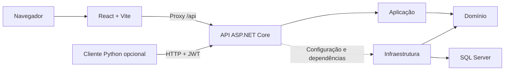
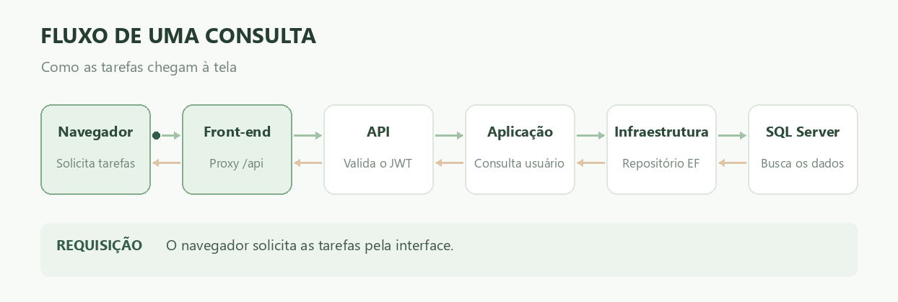
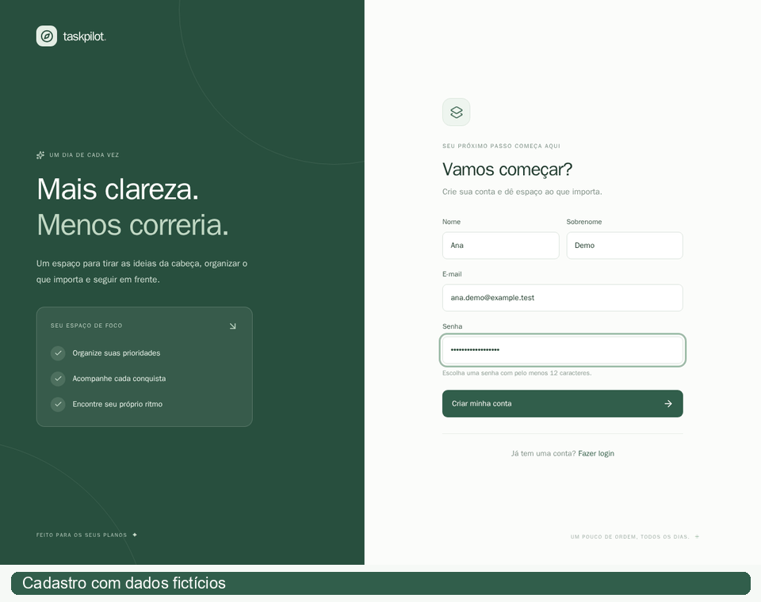

# 🚀TaskPilot API

[](https://github.com/JTBCode86/taskpilot-api/actions/workflows/ci.yml)

## 📑Índice

- [Descrição](#descrição)
- [Pré-requisitos](#pré-requisitos)
- [Arquitetura](#arquitetura)
  - [Fluxo de uma consulta](#fluxo-de-uma-consulta)
- [Estrutura](#estrutura)
- [Demonstração](#demonstração)
- [Como executar](#como-executar)
  - [Ambiente de desenvolvimento com Docker](#ambiente-de-desenvolvimento-com-docker)
- [Interface web](#interface-web)
- [Testes automatizados](#testes-automatizados)
  - [Testes ponta a ponta](#testes-ponta-a-ponta)
- [Autenticação](#autenticação)
- [Migrações do banco](#migrações-do-banco)
- [Cliente Python opcional](#cliente-python-opcional)
- [Desenvolvimento e testes .NET](#desenvolvimento-e-testes-net)
- [Integração contínua](#integração-contínua)
- [Trade-offs de arquitetura](#trade-offs-de-arquitetura)
- [Próximos passos e evoluções](#próximos-passos-e-evoluções)

## 📝Descrição

O TaskPilot é um projeto didático de gerenciamento de tarefas, com API em ASP.NET Core, interface React, SQL Server e cliente de exemplo em Python. A solução permite cadastrar uma conta, autenticar-se e criar, consultar, editar, concluir e excluir as próprias tarefas.

Para criar uma tarefa, autentique-se e informe um título não vazio com até 256 caracteres. A tarefa pertence ao usuário do token; um título inválido retorna HTTP 400.

Tarefas próprias podem ser editadas (título, descrição, prioridade e prazo) ou excluídas permanentemente. A edição não altera o status nem a data de conclusão, inclusive em tarefas concluídas. A interface solicita confirmação antes de excluir.

O prazo é opcional e pode ser definido, alterado ou removido. Na interface, a data vale até o fim do dia no calendário local; tarefas em aberto com data anterior à data local aparecem como atrasadas. Datas passadas são permitidas e tarefas concluídas não são destacadas como atrasadas.

## 📋Pré-requisitos

Para executar a API, a interface e o banco com Docker:

- Git e Docker Engine com Compose e containers Linux.
- Arquitetura x86-64 suportada pela imagem oficial do SQL Server para Linux e pelo menos 2 GB de memória disponíveis para o banco.
- Não é necessário instalar SQL Server, Node.js ou o SDK .NET no computador para usar os containers.

Para desenvolvimento ou testes fora dos containers, instale conforme a necessidade: Node.js 22 para a interface, SDK .NET 10 para os projetos .NET e Python 3.9 ou superior para o cliente Python. Os testes ponta a ponta também precisam do Chromium instalado pelo Playwright.

## 🏗Arquitetura

O fluxo principal combina a interface React/TypeScript, a API ASP.NET Core e o SQL Server. O cliente Python é uma alternativa opcional para consumir a API.



- **API:** expõe os endpoints HTTP, autentica com JWT e configura as dependências.
- **Aplicação:** implementa os casos de uso de tarefas e coordena as operações.
- **Domínio:** reúne entidades, regras e contratos usados pelas demais camadas.
- **Infraestrutura:** implementa acesso a dados e serviços externos; usa Entity Framework Core e procedimentos armazenados existentes.
- **Banco:** armazena os dados no SQL Server; scripts versionados inicializam e atualizam o esquema.

### 🔄Fluxo de uma consulta



No exemplo simplificado, o navegador solicita as tarefas pela interface, e o proxy do Vite encaminha a requisição `/api` à API. Após a validação do JWT, a aplicação solicita os dados ao repositório na infraestrutura, que consulta o SQL Server. A resposta retorna pelo caminho inverso; a interface exibe os prazos e identifica tarefas em aberto atrasadas.

## 📁Estrutura

- `src/TaskPilot/TaskPilot.Domain`: entidades e contratos.
- `src/TaskPilot/TaskPilot.Application`: casos de uso e regras de aplicação.
- `src/TaskPilot/TaskPilot.Infrastructure`: acesso ao SQL Server e serviços externos.
- `src/TaskPilot/TaskPilot.API`: endpoints HTTP e configuração.
- `src/Banco de dados`: scripts SQL e sequência de inicialização.
- `src/taskpilot_client`: cliente Python de demonstração.
- `src/taskpilot_frontend`: interface React e TypeScript.
- `docker`: inicialização do banco e testes de migração.
- `.github/workflows`: configuração da integração contínua.
- `docs`: GIFs de demonstração e do fluxo de informações.

## 🎬Demonstração



A demonstração apresenta cadastro, login, gerenciamento de tarefas, criação, alteração e remoção de prazos, além dos filtros e da ordenação por prioridade e prazo. Os dados exibidos são fictícios.

## ▶Como executar

### 🐳Ambiente de desenvolvimento com Docker

Na raiz do repositório, copie `.env.example` para `.env` e substitua a senha de exemplo por uma senha forte, exclusiva para desenvolvimento. Para o formato da string de conexão usado aqui, não inclua ponto e vírgula, aspas ou cifrão na senha. Ela deve atender à política de complexidade do SQL Server. Defina também `TASKPILOT_JWT_KEY` como um segredo aleatório e exclusivo de pelo menos 32 bytes; a API não inicia sem ele. Nunca compartilhe ou versione `.env`.

No PowerShell, gere um segredo de 32 bytes e copie o resultado para `TASKPILOT_JWT_KEY` no `.env`:

```powershell
$bytes = New-Object byte[] 32
$rng = [System.Security.Cryptography.RandomNumberGenerator]::Create()
try { $rng.GetBytes($bytes) } finally { $rng.Dispose() }
[Convert]::ToBase64String($bytes)
```

No PowerShell:

```powershell
Copy-Item .env.example .env
# Edite .env e configure MSSQL_SA_PASSWORD e TASKPILOT_JWT_KEY.
docker compose up --build -d
docker compose ps -a
docker compose logs db-init api
```

O serviço `db-init` aguarda o banco, inicializa a versão 1 em bancos vazios e aplica as migrações pendentes. Ele deve terminar com sucesso antes da API iniciar. Na primeira execução são criados os status e um usuário de demonstração de ID 1, sem senha utilizável. Se o banco já contiver objetos sem o marcador de inicialização, o processo interrompe a execução para evitar alterar dados existentes.

- Swagger: http://localhost:8080/swagger
- Saúde da API e conexão ao banco: http://localhost:8080/health
- Os endpoints de tarefas exigem um token de acesso; consulte a seção Autenticação.

O Compose publica a API apenas na interface local e não publica a porta do banco. O volume `sql_data` mantém os dados entre reinicializações e `docker compose down`. A senha configurada na criação do volume continua sendo a senha do SQL Server; alterá-la em `.env` não muda a senha existente.
Se a porta 8080 estiver em uso, adicione `TASKPILOT_API_PORT=8081` ao `.env` e ajuste as URLs e `TASKPILOT_API_URL` do cliente.

```powershell
docker compose down
```

**Atenção:** `docker compose down --volumes` apaga permanentemente o banco do projeto. Antes de aplicar migrações, remover volumes ou atualizar o SQL Server, faça um backup e copie-o para fora do volume. Bancos externos sem o marcador de versão não são importados automaticamente; sua adoção requer análise e migração separadas.

Este Compose é apenas para desenvolvimento: usa edição Developer, conexão interna com certificado confiado sem validação e credenciais administrativas. Apesar da autenticação, ainda faltam HTTPS, limitação de tentativas, verificação de e-mail e outros controles para produção. Não exponha a API na internet ou em redes não confiáveis.

## 💻Interface web

Para iniciar a interface React com a API e o banco, após configurar `.env` conforme acima:

```powershell
docker compose --profile frontend up --build -d
```

Abra http://localhost:5173, crie uma conta ou entre com uma conta existente e gerencie suas tarefas. A interface e a API são publicadas apenas em `127.0.0.1`; o servidor de desenvolvimento encaminha `/api` para a API pela rede interna do Compose, sem habilitar CORS indiscriminadamente. Se a porta 5173 estiver ocupada, defina `TASKPILOT_FRONTEND_PORT` no `.env`.

A lista permite filtrar tarefas por status, prioridade e prazo (incluindo as atrasadas) e ordená-las por prazo ou prioridade. Por padrão, as tarefas mais recentes aparecem primeiro.

A sessão fica somente na memória do navegador: atualizar ou fechar a página encerra o acesso local. O token também expira após 30 minutos; sair da interface remove o token local, mas não revoga tokens já emitidos no servidor. A interface utiliza um servidor de desenvolvimento, não uma configuração pronta para produção. Alterações no código da interface exigem reconstruir o container com o comando acima.

Para parar os serviços sem apagar o banco:

```powershell
docker compose --profile frontend down
```

Para desenvolver a interface diretamente no computador, instale Node.js 22, inicie a API com o Compose e execute:

```powershell
cd src\taskpilot_frontend
npm ci
npm run dev
```

O proxy local usa a API em `http://127.0.0.1:8080`; se necessário, defina `TASKPILOT_PROXY_TARGET` antes de iniciar o Vite. Rode `npm run lint`, `npm test` e `npm run build` para validar a interface.

## 🧪Testes automatizados

O projeto inclui testes unitários para .NET, Python e interface, testes de integração contra SQL Server, testes de migração e testes ponta a ponta com Playwright. As instruções de execução estão nas seções [Testes ponta a ponta](#testes-ponta-a-ponta), [Migrações do banco](#migrações-do-banco) e [Desenvolvimento e testes .NET](#desenvolvimento-e-testes-net). O [CI](#integração-contínua) executa esses fluxos em ambientes isolados.

Para executar os testes unitários do cliente Python, no diretório `src\taskpilot_client`:

```powershell
python -m pip install -r requirements.txt
python -m unittest discover -s tests -v
```

Para a interface, no diretório `src\taskpilot_frontend`, execute `npm ci` e `npm test`.

### 🔍Testes ponta a ponta

Os testes Playwright usam o Chromium e criam usuários e tarefas reais. Execute-os somente contra uma instância de teste dedicada, nunca contra dados que queira preservar. Com essa instância e a interface disponíveis, no diretório `src\taskpilot_frontend`:

```powershell
npm ci
npx playwright install chromium
$env:TASKPILOT_E2E_URL = "http://127.0.0.1:5173"
npm run test:e2e
Remove-Item Env:\TASKPILOT_E2E_URL
```

Altere a URL para a porta da instância de teste. Os dados criados permanecem no banco local; no CI, o banco e o volume são isolados e removidos ao final.

## 🔐Autenticação

Os endpoints públicos de login e cadastro têm limites separados por IP: 5 tentativas de login e 3 cadastros por minuto. Ao exceder o limite, a API responde HTTP 429; as tentativas não ficam enfileiradas. O Compose de desenvolvimento, publicado apenas em `127.0.0.1`, usa limites maiores para que os testes locais compartilhem o mesmo endereço sem interferir entre si. Em hospedagem atrás de proxy, configure o encaminhamento de cabeçalhos para confiar somente no proxy conhecido antes de depender do IP do cliente; não confie em `X-Forwarded-For` enviado diretamente por qualquer origem.

Crie uma conta com `POST /api/v1/auth/register`, informando `firstName`, `lastName`, `email` e `password` (12 a 128 caracteres). Depois, use `POST /api/v1/auth/login` com e-mail e senha. O retorno contém `accessToken`, `userId` e `expiresAt`; envie o token como `Authorization: Bearer <token>` nos endpoints de tarefas. Há exemplos em `src/TaskPilot/TaskPilot.API/TaskPilot.http` e no Swagger.

O token expira em 30 minutos. Cada usuário só pode consultar e concluir suas próprias tarefas; o `userId` opcional na criação deve corresponder ao token. Credenciais inválidas ou token ausente retornam 401; tentativas de acesso ao resumo ou criação para outro usuário retornam 403, e a conclusão de uma tarefa de outro usuário retorna 404. Alterar a chave JWT ou a senha invalida os tokens anteriores.

Use `PUT /api/v1/tasks/{taskId}` com `title`, `description` e `priorityLevel` (1 a 3) para editar: a resposta é HTTP 200 com o identificador atualizado. O campo opcional `dueDate` aceita uma data e hora ISO 8601; omiti-lo preserva o prazo, enquanto `null` o remove. A interface envia a data escolhida às 23:59:59.9999999 sem fuso e usa a data armazenada como data de calendário, inclusive para prazos criados por outros clientes. `DELETE /api/v1/tasks/{taskId}` exclui a tarefa e retorna HTTP 204. Tarefas inexistentes ou de outro usuário retornam 404 em ambas as operações; a exclusão também remove os vínculos de categorias da tarefa.

O usuário de demonstração existente continua sem senha utilizável e suas tarefas são preservadas. Para recuperar o acesso, com os containers em execução, use o comando administrativo local abaixo e digite a nova senha duas vezes. Ele exige acesso ao banco pelo Compose e não cria uma rota pública de recuperação:

```powershell
docker compose run --rm --no-deps api reset-password 1
```

Substitua `1` pelo ID desejado. A senha não aparece na digitação; contas inativas não são alteradas. Não passe senhas como argumentos nem compartilhe tokens. A recuperação de contas reais exige um processo administrativo confiável e não deve ser exposta a clientes.

## 🗃Migrações do banco

O histórico fica em `dbo.TaskPilotSchemaVersion`. Bancos criados pela versão anterior, que já possuem a marcação de versão 1, recebem as novas migrações sem recriar tabelas ou dados. A versão 2 adiciona metadados ao histórico; seu registro de versão 1 não tem data nem checksum retroativos.
Os scripts referenciados por `init.sql` compõem a versão 1 e devem permanecer inalterados; mudanças de esquema devem ser feitas em novas migrações.

Para alterar o esquema:

1. Faça backup e adicione um arquivo em `src/Banco de dados/Migrations`, com a próxima versão sequencial de quatro dígitos, por exemplo `0003_adicionar_indice.sql`. Use somente letras minúsculas, números e sublinhados no nome e grave o arquivo em UTF-8 com finais de linha LF.
2. Escreva SQL para uma única transação, sem `GO`, comandos `:sqlcmd`, `USE` ou comandos de controle de transação. Para objetos que exigem ser o primeiro comando do lote, como procedures, use SQL dinâmico com `EXEC(N'...')`. Não inclua operações que não possam ser revertidas pela transação.
3. Pare a API com `docker compose stop api`, execute `docker compose up -d` e confira `docker compose logs db-init`. Cada migração é aplicada uma vez e registrada na mesma transação; falhas impedem a inicialização da API. Uma API que já esteja em execução não é interrompida automaticamente. Uma trava no banco serializa inicializadores concorrentes; caso dois processos tentem criar o banco vazio ao mesmo tempo, um deles pode precisar ser executado novamente.

Os arquivos aplicados são identificados pelo nome e checksum SHA-256. Não edite, renomeie ou remova uma migração aplicada: crie outra para corrigir o esquema. O inicializador também recusa lacunas ou versões desconhecidas no histórico. Após uma falha, investigue os logs e corrija a migração ainda não aplicada antes de tentar novamente. As transações não substituem backups nem testes em uma cópia dos dados.

Os testes de migração usam um banco e volume Docker temporários isolados e os removem ao terminar. No Windows, com a política local permitindo executar scripts PowerShell:

```powershell
.\docker\tests\Test-DatabaseMigrations.ps1
```

## 🐍Cliente Python opcional

O cliente usa Python 3.9+ e não é necessário para executar a API:

```powershell
cd src\taskpilot_client
python -m pip install -r requirements.txt
python main.py
```

Por padrão o cliente acessa `http://localhost:8080`. Para outra instância, defina `TASKPILOT_API_URL` antes de executá-lo. Para HTTPS, o certificado deve ser confiável pelo ambiente Python. O exemplo faz login e cria e conclui uma tarefa da conta informada. Cadastre a conta primeiro, defina `TASKPILOT_EMAIL` e `TASKPILOT_PASSWORD` no ambiente local e remova essas variáveis após o uso. Não versione credenciais.

## 🛠Desenvolvimento e testes .NET

Para compilar ou executar testes fora dos containers, instale o SDK .NET 10:

```powershell
dotnet build .\src\TaskPilot\TaskPilot.API\TaskPilot.API.csproj
dotnet test .\src\TaskPilot\TaskPilot.sln
```

Os testes de integração exigem uma instância de desenvolvimento dedicada, já inicializada pelo Compose. Eles criam tarefas permanentes no banco; não os execute em produção. Para habilitá-los:

```powershell
$env:TASKPILOT_INTEGRATION_URL = "http://localhost:8080"
dotnet test .\src\TaskPilot\TaskPilot.Integration.Tests\TaskPilot.Integration.Tests.csproj
Remove-Item Env:\TASKPILOT_INTEGRATION_URL
```

Sem essa variável, os testes de integração são marcados como inconclusivos. Para executar a API diretamente no host, configure `ConnectionStrings__TaskPilotDBConnection` com uma conexão SQL Server válida e `Jwt__SigningKey` com um segredo aleatório; o Compose não publica o banco no host por padrão.

## 🔁Integração contínua

O GitHub Actions executa o CI em cada push e pull request, ou manualmente pela aba Actions. O fluxo verifica, testa e compila a interface, compila a solução, executa os testes unitários .NET e Python, e testa a API, a recuperação local, o cliente Python e o fluxo ponta a ponta no Chromium contra SQL Server em containers. Uma etapa separada verifica as migrações em um banco temporário. Os testes de integração precisam executar e passar, sem serem ignorados.

Os ambientes de teste usam projetos e volumes Docker isolados, removidos ao final; a senha do banco, a chave JWT e as credenciais do cliente de teste são geradas para cada execução. O CI não faz deploy.

## ⚖Trade-offs de arquitetura

| Decisão | Benefícios | Limitações |
| --- | --- | --- |
| SQL Server em container | Dispensa a instalação local do banco e aproxima os ambientes de desenvolvimento. | Exige Docker, memória e arquitetura compatível. O volume mantém os dados e precisa de backup. |
| Interface via servidor de desenvolvimento e proxy | Mantém a API na mesma origem do navegador sem liberar CORS globalmente; é prático localmente. | Não é uma configuração de hospedagem de produção. |
| Token em memória | Reduz a persistência local do token. | Exige novo login ao atualizar ou fechar a página. Sair remove o token da interface, sem revogá-lo no servidor. |
| Entity Framework Core e procedimentos armazenados | Permitem estudar as duas abordagens de acesso a dados. | Exigem manter lógica de acesso a dados em mais de um lugar e cuidar da compatibilidade das migrações. |

## 🧭Próximos passos e evoluções

Ideias para evolução do projeto:

1. **Segurança e produção:** avaliar HTTPS, limitação de tentativas, verificação de e-mail e uma configuração de hospedagem adequada antes de expor a aplicação.
2. **Observabilidade:** planejar logs estruturados, métricas e rastreamento de requisições para monitorar a aplicação e facilitar o diagnóstico de falhas, sem registrar dados sensíveis.
